  

  <b>Morocco · Available immediately · Remote or on-site</b>

  
  
  

## About

Since 2021 I ship WordPress sites, web apps and automations for agencies and remote clients: fast, well-ranked and easy to maintain.

- **WordPress & WooCommerce**: custom themes, Elementor, custom plugins, multilingual sites
- **Technical SEO**: Core Web Vitals, Search Console, structured content, Google Ads
- **Automation**: n8n and Make.com pipelines that write, optimise and publish SEO articles and social posts
- **AI-assisted development**: Claude Code, Cursor, MCP servers. Every change is reviewed and tested before production.
- **Apps**: React, Next.js, Node.js, FastAPI

## Selected work

| Project | What it is | Stack |
|---|---|---|
| **SWSM 2026** | International scientific conference site (programme, committees, registration, paper submission), connected to AI agents through an MCP server | WordPress, MCP |
| **normes-haccp.com** | HACCP platform for food service: WordPress + SEO + partial workflow automation, React front-end for the HACCP app | WordPress, React, n8n |
| **Automated SEO content pipeline** | Generates, optimises and publishes articles, then shares them on social media with no manual step | n8n, Make.com, APIs, AI |
| **varimart.ma** | Home & lifestyle marketplace with promo packs and blog | WooCommerce |
| **Mochis Mochis** | Stock-management web app for a sushi stand | Next.js, React |
| **[portfolio-2026](https://github.com/Mechkouri/portfolio-2026)** | My portfolio | see repo |

More on the [portfolio](https://mechkouri.netlify.app).

## Stack

  

Automation: n8n · Make.com · webhooks · REST APIs

## Let's talk

Open to web developer roles (WordPress, full-stack) and freelance projects. Email me or message me on LinkedIn.
